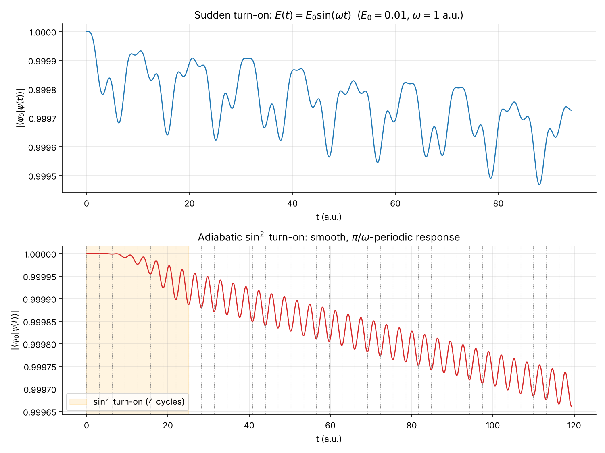
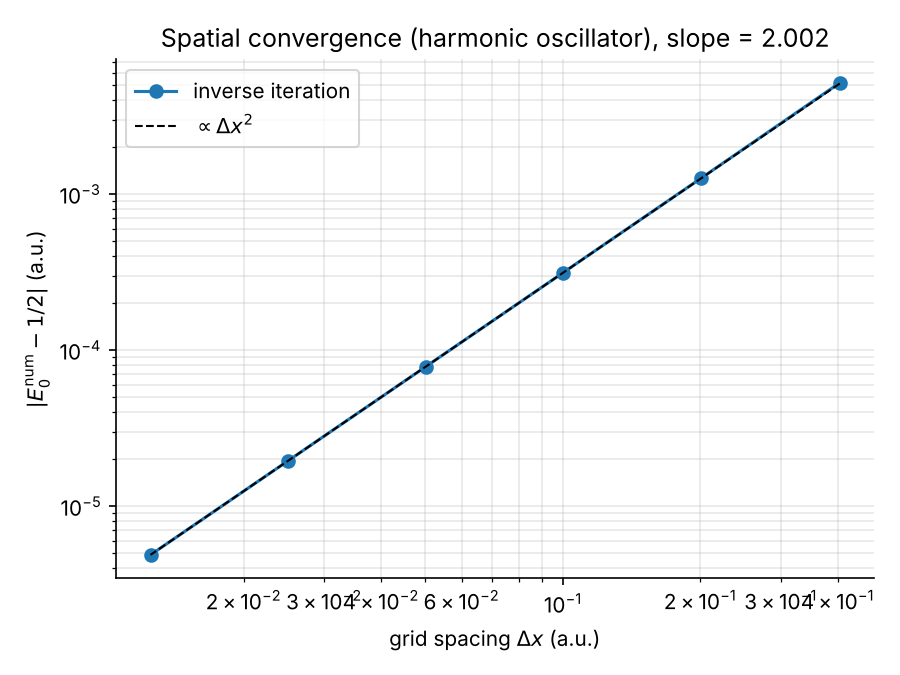
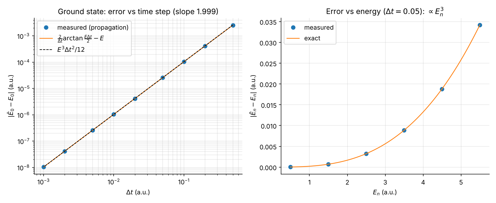
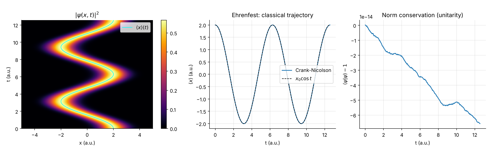
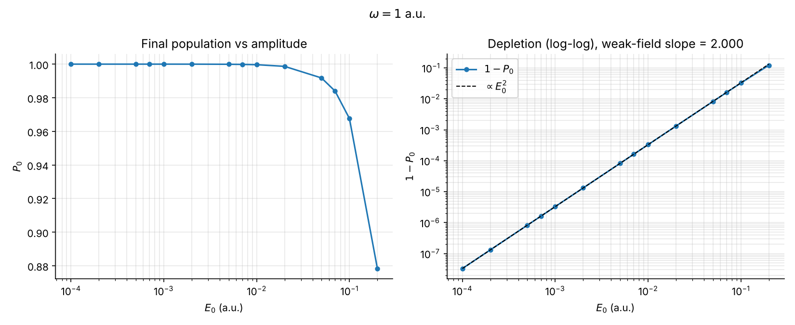
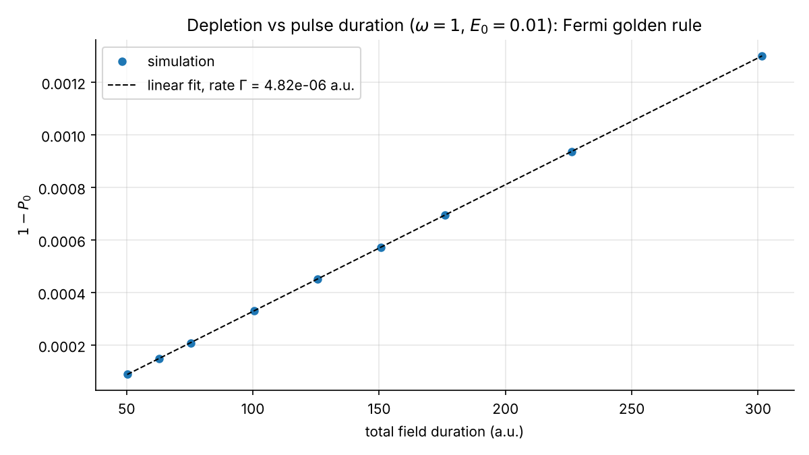
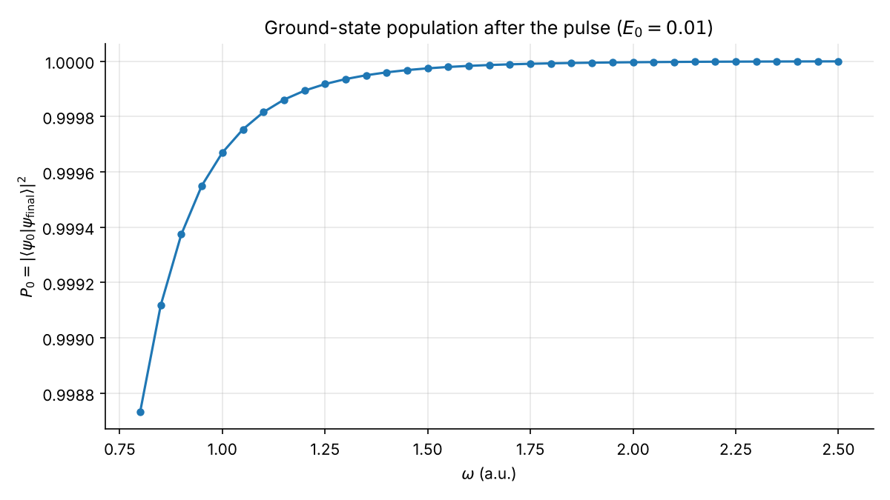
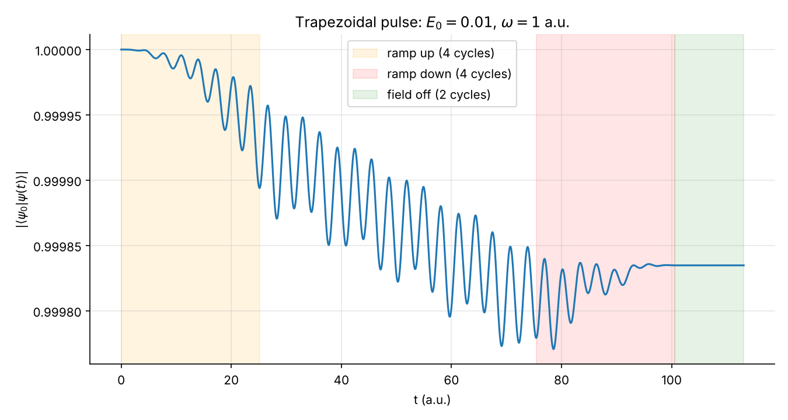
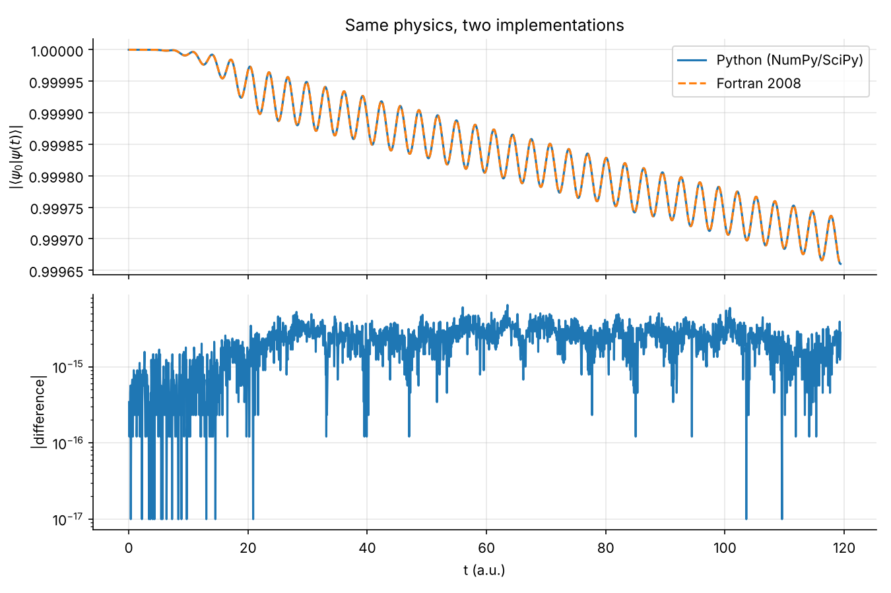

# Crank–Nicolson solver for the time-dependent Schrödinger equation

[](https://github.com/feuernath-design/Crank-Nicholson-Applied-numerical-methods-in-Numpy-for-quantum-mechanics-/actions/workflows/ci.yml)


Numerical solution of the 1D time-dependent Schrödinger equation (TDSE) with the Crank–Nicolson scheme, in **Python (NumPy/SciPy)** and **Fortran 2008**, applied to a model atom driven by a laser field (one-photon ionisation).

This work comes from my research internship in quantum mechanics at the **CNRS (Paris, summer 2026)**. The internship scripts were refactored into a tested package; every figure below is regenerated by a script in [`scripts/`](scripts/).

<p align="center">
  
</p>

## Highlights

- **O(N) Crank–Nicolson propagator** for $H(t) = -\tfrac12\partial_x^2 + V(x) + E(t)\,x$, with mid-point evaluation of the field (second order in time) and banded LAPACK solves.
- **Shifted inverse iteration** with an accelerated shift update for stationary states (7 iterations for the soft-Coulomb ground state instead of 25).
- **Fortran 2008 port** (Thomas algorithm, namelist input) that agrees with Python to **6 × 10⁻¹⁵**.
- **Verified numerics**: norm conserved to ~10⁻¹⁴, spatial order 2.003, temporal order 1.999, eigenstate phase equal to the closed-form Cayley phase $\tfrac{2}{\Delta t}\arctan\tfrac{E\Delta t}{2}$ to round-off.
- **Physics**: 1 − P₀ ∝ E₀² (slope 2.0000) and linear in pulse duration (Fermi's golden rule), adiabatic vs sudden turn-on of the field.
- 48 automated tests (pytest), lint (ruff) and Fortran build checked by GitHub Actions on Python 3.10–3.13.

## The method in one equation

$$
\Big(1 + \tfrac{i\Delta t}{2}\,H_{n+1/2}\Big)\,\psi^{n+1} \;=\; \Big(1 - \tfrac{i\Delta t}{2}\,H_{n+1/2}\Big)\,\psi^{n}
$$

The one-step propagator is the Cayley transform of $H$, which is **exactly unitary** (norm conserved for any $\Delta t$), **unconditionally stable**, **time-reversible** and **second-order accurate**. With finite differences, $H$ is tridiagonal, so each step costs $O(N)$. Full derivations (unitarity, phase-error formula, inverse iteration, perturbation-theory predictions) are in [`docs/theory.md`](docs/theory.md).

## Results

### 1. Spatial convergence — `scripts/01_spatial_convergence.py`

Harmonic-oscillator ground state from inverse iteration versus the exact $E_0 = 1/2$: the 3-point Laplacian gives an $O(\Delta x^2)$ error (measured slope **2.003**).



### 2. Temporal error — `scripts/02_time_step_error.py`

An eigenstate only acquires a phase; Crank–Nicolson makes it evolve with $\bar E = \tfrac{2}{\Delta t}\arctan\tfrac{E\Delta t}{2} \simeq E - E^3\Delta t^2/12$. The error measured by propagation matches the closed form exactly: slope **1.999** in $\Delta t$, growth $\propto E_n^3$ with energy.



### 3. Coherent state — `scripts/03_harmonic_wavepacket.py`

A displaced Gaussian in a harmonic trap oscillates rigidly along the classical trajectory $x_0\cos t$ (Ehrenfest theorem), with the norm conserved to 10⁻¹³.



### 4. Driven atom: sudden vs adiabatic turn-on — `scripts/04_driven_atom.py`

Soft-Coulomb atom $V = -1/\sqrt{1+x^2}$ ($E_0 = -0.6699$ a.u.) in a field $E_0 = 0.01$, $\omega = 1$ a.u. (figure at the top).
A sudden turn-on excites the free response of the atom, which beats at $\omega \pm \omega_{10}$ ($\omega_{10} = 0.395$ a.u.). With a 4-cycle $\sin^2$ turn-on the response becomes smooth and $\pi/\omega$-periodic (adiabatic polarisation, $\propto E(t)^2$), with a slow decay due to ionisation.

The irregular curve is **physics, not a numerical artefact**: the script checks that the norm is conserved to 4 × 10⁻¹⁵, that halving $\Delta t$ changes the result by only 7 × 10⁻⁷, and that without field $|\langle\psi_0|\psi\rangle| = 1$ to 3 × 10⁻¹⁴.

### 5. Photo-ionisation scans — `scripts/05_photoionization_scans.py`

Trapezoidal pulses (4-cycle ramps) followed by 2 field-free cycles; $P_0 = |\langle\psi_0|\psi_{\rm final}\rangle|^2$.

| Amplitude scan (ω = 1) | Duration scan (ω = 1, E₀ = 0.01) |
|---|---|
|  |  |
| 1 − P₀ ∝ E₀² (first-order perturbation theory), slope **2.0000** for E₀ ≤ 0.01 | 1 − P₀ linear in the duration: constant ionisation rate Γ ≈ 4.8 × 10⁻⁶ a.u. (Fermi's golden rule) |

| Frequency scan (E₀ = 0.01) | Time trace (trapezoid) |
|---|---|
|  |  |
| All ω above $I_p = 0.67$ a.u.: depletion decreases with ω like the photo-ionisation cross-section | The overlap freezes once the field is off: the remaining loss is real ionisation |

### 6. Fortran vs Python — `scripts/06_fortran_vs_python.py`

Same algorithm in both languages (3001 points, 2432 steps): maximum difference **6.4 × 10⁻¹⁵** on $|\langle\psi_0|\psi(t)\rangle|$. Propagation time on one core: Fortran 0.39 s, Python/SciPy 0.51 s — NumPy vectorisation plus a LAPACK banded solver keeps Python within ~30 % of compiled code here.



## Getting started

```bash
git clone https://github.com/feuernath-design/Crank-Nicholson-Applied-numerical-methods-in-Numpy-for-quantum-mechanics-.git
cd Crank-Nicholson-Applied-numerical-methods-in-Numpy-for-quantum-mechanics-
python -m pip install -e ".[dev]"

pytest                                  # 48 tests (Fortran tests need gfortran)
python scripts/04_driven_atom.py        # any script; --show to display, --quick for a fast run
make figures                            # regenerate every figure
```

### Python API

```python
import numpy as np
from tdse1d import (Grid, Hamiltonian1D, CrankNicolson, LaserField,
                    inverse_iteration, sin2_ramp_envelope, potentials)

grid = Grid.from_spacing(-150.0, 150.0, 0.1)
h0 = Hamiltonian1D(grid, potentials.soft_coulomb(grid.x))
ground = inverse_iteration(h0, shift=-1.0)              # E0 = -0.6699 a.u.

omega = 1.0
period = 2 * np.pi / omega
field = LaserField(0.01, omega, sin2_ramp_envelope(4 * period))
prop = CrankNicolson(h0, dt=period / 128, field=field)

result = prop.propagate(
    ground.state, n_steps=19 * 128,
    observables={"overlap": lambda psi: abs(grid.inner(ground.state, psi)),
                 "norm": grid.norm2},
)
print(result["overlap"].min(), abs(result["norm"] - 1).max())   # 0.99966, ~1e-14
```

### Fortran

```bash
cd fortran
make                                   # optimised build  -> build/cn_propagate
make debug                             # -fcheck=all, FP traps, -Werror
./build/cn_propagate examples/soft_coulomb.nml
./build/cn_propagate examples/harmonic_wavepacket.nml
```

Parameters are read from a namelist (`&config`, see [`fortran/examples/`](fortran/examples/)); the output is a CSV file `t, norm, x_mean, overlap_abs`.

## Repository layout

```
├── src/tdse1d/               Python package
│   ├── grid.py               uniform grid, grid-weighted inner products
│   ├── potentials.py         harmonic, soft-Coulomb, free
│   ├── hamiltonian.py        tridiagonal finite-difference Hamiltonian
│   ├── eigen.py              shifted inverse iteration
│   ├── propagator.py         Crank-Nicolson propagator, absorbing mask
│   ├── fields.py             laser field and envelopes (constant, sin^2, trapezoid)
│   ├── states.py             Gaussian wavepackets
│   ├── analysis.py           Cayley phase error, convergence slopes
│   └── reference.py          dense "textbook" CN, used as a test oracle
├── fortran/                  Fortran 2008 solver (module + driver + Makefile)
├── scripts/                  one script per figure (01 ... 06)
├── tests/                    pytest suite, incl. Fortran/Python cross-validation
├── figures/                  generated figures
└── docs/theory.md            derivations and physics discussion
```

## Validation summary

| Check | Result |
|---|---|
| Norm conservation (any Δt, with and without field) | < 10⁻¹² (typically 10⁻¹⁴) |
| Banded solver vs dense `np.linalg.solve` reference | < 10⁻¹² |
| Eigenstate phase vs $\tfrac{2}{\Delta t}\arctan\tfrac{E\Delta t}{2}$ | < 10⁻¹¹ |
| Time reversibility $U(-\Delta t)U(\Delta t) = 1$ | < 10⁻¹¹ |
| Spatial / temporal convergence order | 2.003 / 1.999 (2.00 with field) |
| Inverse iteration vs LAPACK `eigh_tridiagonal` | < 10⁻¹¹ for the 6 lowest levels |
| Fortran vs Python | < 10⁻¹⁰ (tests), 6 × 10⁻¹⁵ (script 06) |

## References

- J. Crank and P. Nicolson, Proc. Camb. Phil. Soc. **43**, 50 (1947).
- A. Goldberg, H. M. Schey and J. L. Schwartz, Am. J. Phys. **35**, 177 (1967).
- J. Javanainen, J. H. Eberly and Q. Su, Phys. Rev. A **38**, 3430 (1988).
- J. L. Krause, K. J. Schafer and K. C. Kulander, Phys. Rev. A **45**, 4998 (1992).

## Author

**Nathan Feuerstein** — Electrical engineering student at Polytechnique Montréal. Research internship in quantum mechanics, CNRS (Paris), summer 2026.

Released under the [MIT License](LICENSE).
